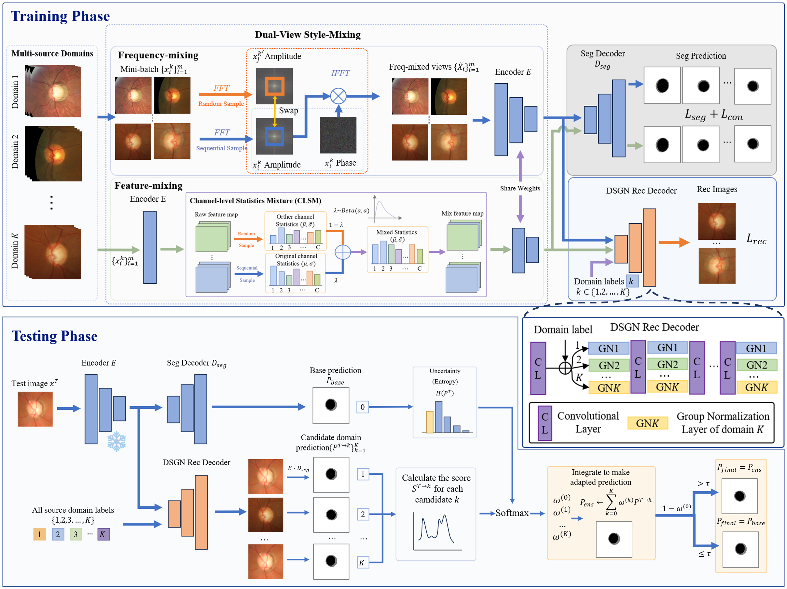

# RGTTA: Reconstruction-Guided Optimization-Free Test-Time Adaptation for Medical Image Segmentation



RGTTA aims to improve the generalization ability of segmentation models under domain shifts without updating model parameters during inference. The framework introduces **dual-view style mixing**, **domain-conditioned reconstruction**, and **test-time domain prediction ensemble** to achieve robust adaptation across unseen medical imaging domains.

The method is evaluated on three representative medical image segmentation tasks:

- Retinal fundus segmentation

- Polyp segmentation

- Prostate MRI segmentation

------

## Installation

### Prerequisites

- Python >= 3.8
- PyTorch >= 1.12

### Install dependencies:

```
pip install -r requirements.txt
```

## Datasets

RGTTA supports three medical segmentation benchmarks.

### Retinal Fundus Segmentation

Supported domains:

- RIM-ONE-r3
- REFUGE
- ORIGA
- REFUGE-Valid
- Drishti-GS

### Polyp Segmentation

Supported domains:

- CVC-ClinicDB
- ETIS-LaribPolypDB
- Kvasir-SEG
- BKAI

### Prostate Segmentation

Supported domains:

- BIDMC
- BMC
- HK
- I2CVB
- RUNMC
- UCL

## Source Model Training

### Fundus

Train the model:

```
cd fundus
```

```
python train.py  --dataset_root your_dataset_root --Source_Dataset REFUGE ORIGA REFUGE_Valid Drishti_GS  --Target_Dataset RIM_ONE_r3 --save_pre_model save_your_model
```

### Polyp

Train the model:

```
cd polyp
```

```
python train.py  --dataset_root your_dataset_root --Source_Dataset CVC-ClinicDB ETIS-LaribPolypDB BKAI  --Target_Dataset Kvasir-SEG --save_pre_model save_your_model
```

### Prostate

Train the model:

```
cd prostate
```

```
python train.py  --dataset_root your_dataset_root --Source_Dataset BIDMC HK I2CVB RUNMC UCL  --Target_Dataset BMC --save_pre_model save_your_model
```

## Testing

Testing is performed without updating model parameters.

### Fundus

```
python test.py  --dataset_root your_dataset_root  --Target_Dataset RIM_ONE_r3  --pre_train_model --pre_model your_model
```

### Polyp

```
python test.py  --dataset_root your_dataset_root  --Target_Dataset Kvasir-SEG  --pre_train_model --pre_model your_model
```

### Prostate

```
python test.py  --dataset_root your_dataset_root  --Target_Dataset BMC  --pre_train_model --pre_model your_model
```

